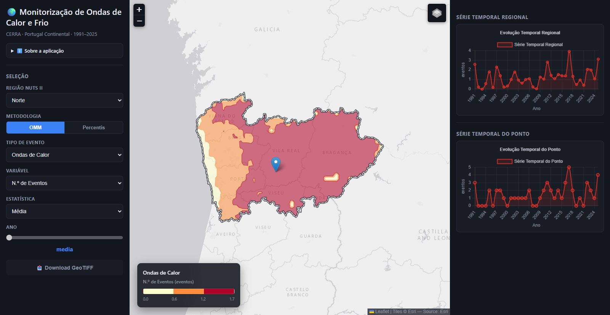
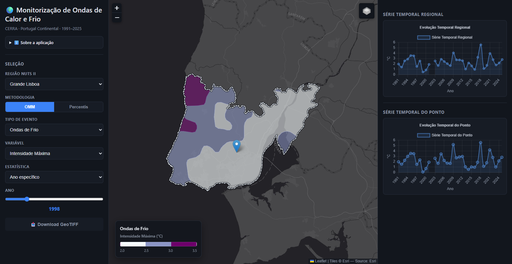
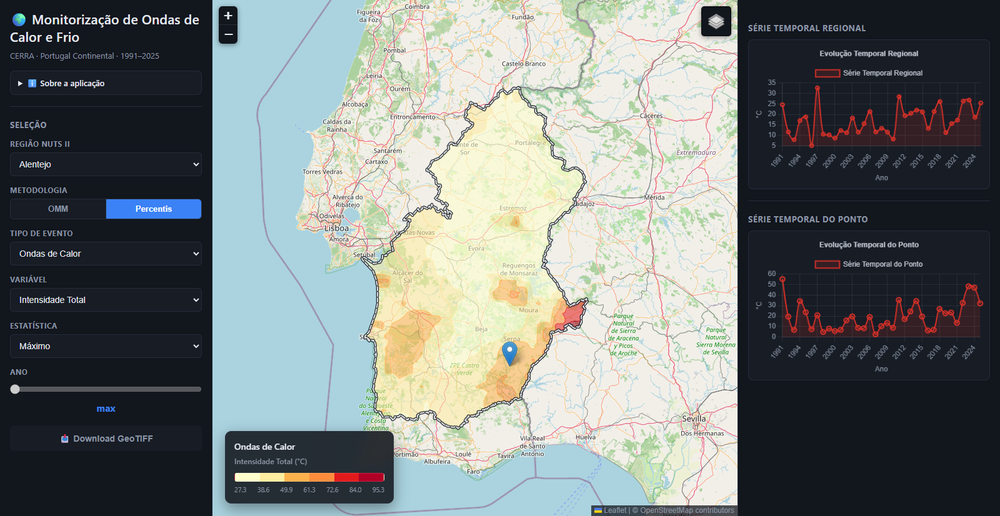
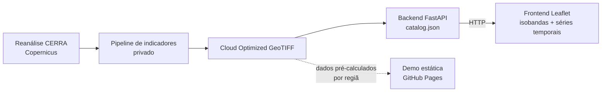

# Ondas de Calor e Frio — WebApp (Showcase)

**[Ver a demo ao vivo →](https://drodrigues704-coder.github.io/ondas_calor_frio_app/)**

WebApp WebGIS para visualização de indicadores climáticos relacionados
com **ondas de calor** e **ondas de frio** em Portugal Continental,
entre 1991 e 2025, a partir dos dados de reanálise **CERRA**
(Copernicus).

> Este repositório é uma apresentação pública do projeto (capturas de
> ecrã, metodologia, stack) — não contém código. A demo ao vivo acima
> corre a app real (sem backend, dados por região pré-calculados); o
> código-fonte completo, o pipeline de dados e o histórico de
> desenvolvimento mantêm-se num repositório privado.

## Capturas de ecrã

**Ondas de calor (OMM) — número de eventos, média de longo prazo, região Norte**

**Ondas de frio (OMM) — intensidade máxima em 1998, Grande Lisboa**

Nos gráficos, a falha em 2002 é intencional: nesse ano não houve
ondas de frio OMM, por isso a intensidade não existe (não é zero).

**Ondas de calor (Percentis) — intensidade total, máximo de longo prazo, Alentejo**

## O que é

Permite selecionar uma região (NUTS II), uma metodologia de deteção,
um evento, uma variável e um ano, e visualizar o resultado no mapa
como isobandas coloridas, com legenda dinâmica e séries temporais
(regional e por ponto clicado).

## Funcionalidades

- **Duas metodologias de deteção**, selecionáveis em tempo real — em
  ambas, uma onda é um período de pelo menos 6 dias consecutivos:
  - **OMM** — temperatura máxima (mínima) mais de 5 °C acima (abaixo)
    do valor normal para esse dia do ano.
  - **Percentis** — temperatura máxima acima do P90 (mínima abaixo do
    P10) da climatologia local de cada célula para esse dia do ano.
  - Período de referência da climatologia: **1991–2020**.
- **Seleção por região (NUTS II)**.
- **Cinco variáveis por evento**: número de eventos, dias em evento,
  duração máxima, intensidade máxima e intensidade total.
- **Renderização por isobandas** — áreas vetoriais suaves entre
  isolinhas, com legenda em gradiente contínuo.
- **Séries temporais** — evolução regional e no ponto clicado no mapa.
- **Basemaps alternativos** (escuro / claro / rua / híbrido).
- **Layout responsivo** — mapa, controlos e gráficos adaptados a ecrã de
  telemóvel, incluindo suporte a toque e a orientação do ecrã.

Na demo pública, o botão de download do GeoTIFF fica visível mas
desativado — é intencionalmente uma versão só de visualização.

## Arquitetura

O backend nunca faz cálculo climatológico — só resolve, no
`catalog.json`, qual ficheiro servir para cada combinação de
metodologia/evento/variável/região/ano. A demo pública (GitHub Pages)
não tem backend: usa um recorte pré-calculado dos mesmos dados.

## Stack tecnológico

| Camada | Tecnologia |
|---|---|
| Pipeline de indicadores + backend (privados) | Python · FastAPI · rasterio · GDAL · geopandas |
| Frontend (demo pública) | JavaScript vanilla · Leaflet · Turf.js (isobandas) · Chart.js |
| Dados | Cloud Optimized GeoTIFF (COG), reanálise CERRA, CRS EPSG:3857 |

## Equipa de agentes (Claude Code)

O desenvolvimento foi estruturado com uma equipa de 7 subagentes
especializados (Claude Code), cada um focado numa área concreta do
projeto — backend/API, frontend WebGIS, dados espaciais (GDAL/rasterio),
metodologia climatológica, revisão de código e validação funcional —
orquestrados segundo regras próprias que decidem, consoante o tipo de
tarefa, quais especialistas participam e em que ordem.

## Autor

Daniel Rodrigues

---

Para uma proposta de serviço de monitorização climática para outra
região, ou esclarecimentos sobre a metodologia, contactar:
**Daniel Rodrigues** — drodrigues704@gmail.com · 963 240 494

© Daniel Rodrigues. Todos os direitos reservados — condições completas
em [LICENSE.md](LICENSE.md). Este conteúdo é disponibilizado para fins
de demonstração e avaliação de competências — não inclui licença de
uso, reprodução ou exploração comercial da metodologia, código ou
dados subjacentes.
